# Visual design decisions

This is the living record of how DeutschDrill turns grammar and vocabulary into
visual associations. Each component below was shown as two or three mocked options
(A, B, C) using real cards from the lessons. One option was chosen per component.

Use this page to review the choices after practising with them, and to change them.
Every option stays documented, with its screenshot, so a decision can be reversed
without redesigning from scratch.

The design rules every component follows (the colour roles, colour never the only
signal, active versus inactive items, when a visual may appear, giveaways, explicit
metadata, one shared renderer, text fit, and piloting on one lesson first) live in
the [Project Constitution](project-constitution.md#visual-language). This page
records the options, the reasons for each choice, and how each one was rolled out.

## Current choices

Chosen by the learner on 2026-10-12: **1A, 2A, 3C, 4C, 5A, 6A, 7A, 8A, 9A, 10C**.
Component 11 was added for Phase 6. Its option **11A** is a provisional default: the
learner was unavailable and asked for autonomous work, so the recommended option was
built. Review it like any other choice. Row 12 (Phase 7) is not a new design: it
places the approved components in the rule guide, so it was built across lessons at
once and waits for review.

| # | Component | Choice | Visible | Status |
|---|---|---|---|---|
| 1 | [Gender colour](#1-gender-colour) | **A** — Menschen dot | Learn; practice before Check when the noun is not the answer | Rolled out (Phase 1) |
| 2 | [Stem + ending](#2-stem--ending-split) | **A** — muted stem, coloured ending | Learn; after Check | Rolled out (Phases 1–2) |
| 3 | [Paradigm mini-map](#3-paradigm-mini-map) | **C** — one-row strip for the current case | Learn; after Check | Rolled out (Phases 1–2) |
| 4 | [Example focus](#4-focus-inside-the-example) | **C** — gender-linked colour + underlined ending | Learn; after Check | Rolled out (Phase 1) |
| 5 | [Sentence structure](#5-sentence-structure) | **A** — position boxes | Learn; after Check | Rolled out (Phase 3) |
| 6 | [Vocabulary picture](#6-pictures-for-concrete-words) | **A** — picture above the word | Learn; practice before Check | Rolled out (Phase 5) |
| 7 | [Frequency](#7-frequency-scale) | **A** — 0–100 % bar | Learn; practice before Check (German labels after Check) | Rolled out (Phase 4) |
| 8 | [Clock](#8-clock-for-time-expressions) | **A** — analog clock | Learn; practice before Check (reading after Check) | Rolled out (Phase 4) |
| 9 | [haben / sein](#9-haben-vs-sein-in-perfekt) | **A** — movement vs action icon | Learn; after Check | Rolled out (Phase 2) |
| 10 | [Guide tables](#10-rule-tables-in-the-guide) | **C** — "what changes" table | Guide panel | Rolled out (Phases 1–2) |
| 11 | [Library class map](#11-library-class-map) | **A** — groups by class with glyph tiles | Library | Rolled out (Phase 6), provisional |
| 12 | [Rule illustrations](#12-illustrations-in-the-guide-rules) | Reuses 5, 6, 7, 8, 9 and the local-preposition scenes | Guide panel; in practice hidden until Check when it would reveal the answer | Built (Phase 7), awaiting review |

"Rolled out" means the design was approved after its pilot and now runs in every
lesson listed under [Phase 1 coverage](#phase-1-coverage),
[Phase 2 coverage](#phase-2-coverage),
[Phase 3 coverage](#phase-3-coverage),
[Phase 4 coverage](#phase-4-coverage),
[Phase 5 coverage](#phase-5-coverage) and
[Phase 6 coverage](#phase-6-coverage). "Built, awaiting review" means the design runs
in every lesson listed under [Phase 7 coverage](#phase-7-coverage) and waits for the
learner's review. "Piloted" means the
design runs in one pilot lesson and waits for the learner's review. "Planned" means
nothing is built yet; the phase and pilot lesson are listed in [Rollout](#rollout).

## How to change a decision

1. Practise with the pilot and note what helps or gets in the way in
   [Review notes](#review-notes).
2. Pick a different option (or a mix) for the component and update its
   **Decision** line and the [Current choices](#current-choices) table.
3. Add a row to the [Decision log](#decision-log) with the date and the reason.
4. If the change affects a product rule (for example, *when* a visual may appear),
   update the Constitution's "Visual language" section in the same change.
5. Re-pilot on one lesson, check it in learn and practice on desktop and phone, and
   roll it out only after review.

Most switches are renderer-only: the lesson data already stores the complete
information (for example, every card keeps its full paradigm), so changing how it
is drawn does not require editing card data.

---

## 1. Gender colour

**Encodes:** the noun's gender — **der** blue, **das** green, **die** red,
**Plural** yellow (Menschen).
**Applies to:** the noun a card is about, including noun headwords and plurals in
travel, es gibt, time, everyday and directions lessons and the place noun in local
prepositions.
**Visible:** learn cards; practice before Check only when gender is not the answer
being practised; always after Check.

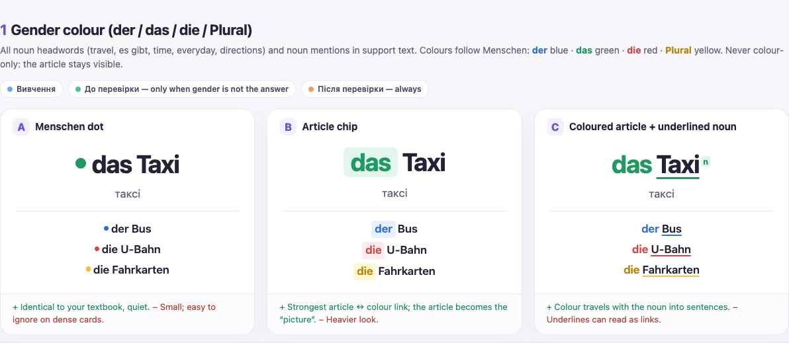

| Option | Design | Strength | Weakness |
|---|---|---|---|
| **A ✅** | Menschen dot: a coloured dot before the article and noun (`● das Taxi`) | Identical to the textbook; quiet | Small; easy to ignore on dense cards |
| B | Article chip: the article sits in a coloured chip | Strongest article ↔ colour link | Heavier look |
| C | Coloured article + underlined noun + gender tag | Colour travels with the noun into sentences | Underlines can read as links |

**Decision:** A — Menschen dot.

**In the app:** a decorative dot (hidden from screen readers), then the article and
noun in dark text (`der Bruder`), then the Ukrainian gender name
(`чоловічий рід`). The gender name stays because *die* is both feminine and plural,
so the colour is never the only signal. A noun with a plural shows both entries
(`● der Baum чоловічий рід / ● die Bäume множина`).
When the learn headword already is the article and noun (`der Bahnhof`,
`das Kino / die Kinos`), each headword entry gets its own dot and the line under the
translation shows only the gender names, so the noun is not printed twice.
In practice the line is a meaning hint: it appears before Check when the answer
does not contain the noun (possessive, `es gibt` and preposition gaps) and waits
until Check when it would give the answer away (recalling `der Bahnhof` from
`вокзал`).
**Data:** `noun: { article, word, gender, exampleWord, plural?, givenInPractice? }`,
built with `nounMeta()` in `script.js`.
**Switching:** renderer-only (`renderNounGender`, `renderStudyHeadword` in `app.js`
and their CSS).

## 2. Stem + ending split

**Encodes:** which part of a form changes — the ending, and later the changed stem
vowel (`a → ä`).
**Applies to:** possessives, possessive cases, pronoun cases, conjugation, strong
verbs, sein.
**Visible:** learn cards; after Check in practice.

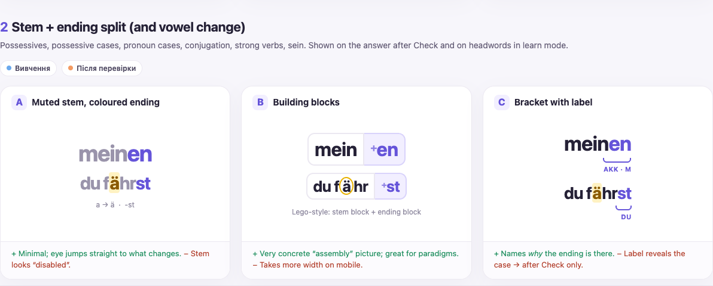

| Option | Design | Strength | Weakness |
|---|---|---|---|
| **A ✅** | Muted stem, coloured ending (`mein`**`en`**; `f`**`ä`**`hr`**`st`**) | Minimal; the eye jumps to what changes | Stem looks "disabled" |
| B | Building blocks: stem block + ending block | Very concrete "assembly" picture | Takes more width on phones |
| C | Bracket with a label (`Akk · m`) | Names why the ending is there | The label reveals the case |

**Decision:** A — muted stem, coloured ending.

**In the app:** the learn headword shows the stem in grey and the ending in the
noun's gender colour. After Check in practice, the case strip (3C) shows the ending.

**Phase 2 pilot (strong-verbs):** the changed stem vowel gets an amber background
(`f`**`ä`**`hr`**`st`**), in the headword, the strip and the example sentence. The
background is the second signal besides colour. The pronoun and a separable prefix
stay muted grey around the form (`du fährst`, `er / sie / es fängt an`). Verbs have
no gender, so their ending uses the app accent (purple). `ich weiß` has a changed
vowel and no ending.

**Rolled out (Phase 2):** every verb card with a person strip (3C) splits its form the
same way: sein, conjugation (`arbeit`**`est`**), haben / bekommen / brauchen
(`ha`**`st`**) and können / mögen / möchten (`k`**`a`**`nn`). Only a vowel change gets
the amber background (`ö → a` in können and mögen); other irregularities are named in
the strip caption instead. Personal-pronoun cards show the whole pronoun as the
answer (`ihn`), with no ending.
**Data:** `answerParts: { stem, ending }`, which must join to the canonical answer;
a vowel change adds `vowel: { start, end }` (indices in the stem). In `script.js`
the strong-verb forms are written compactly as `f[ä]hr|st` (`[…]` the vowel, `|` the
ending).

## 3. Paradigm mini-map

**Encodes:** where the answer lives in its paradigm (case × gender for articles and
pronouns; person × form for verbs).
**Applies to:** possessive cases, pronoun cases, conjugation.
**Visible:** learn cards; after Check in practice (it contains the answer).

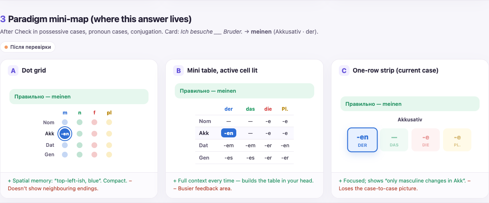

| Option | Design | Strength | Weakness |
|---|---|---|---|
| A | Dot grid: case × gender dots with the answer's dot lit | Spatial memory; compact | Doesn't show neighbouring endings |
| B | Mini table with the active cell lit | Full context every time | Busier feedback area |
| **C ✅** | One-row strip: the current case's four endings, the answer's tile lit | Focused; shows "only masculine changes in Akk" | Loses the case-to-case picture |

**Decision:** C — one-row strip for the current case.

**In the app:** a caption such as `Akkusativ · mein + закінчення`, then four tiles
(`-en DER`, `— DAS`, `-e DIE`, `-e PLURAL`). The answer's tile is filled and
outlined in its gender colour and marked as current for screen readers. Unlike the
mock-up, the other tiles are not faded: fading would drop text contrast below
4.5:1, so they stay on white with a light border instead.
The case-to-case picture this option loses is available in the guide table (10C).
**Data:** `paradigm` keeps every row; `active` points at the answer's cell.
**Switching:** renderer-only (`renderCardParadigm`). Going back to B or A needs no
card-data changes.

**Phase 2 pilot (strong-verbs):** the strip becomes a person strip: caption
`Präsens · fahren · a → ä`, then six tiles in two rows of three (`fahre ich`,
`fährst du`, `fährt er/sie/es`, `fahren wir`, `fahrt ihr`, `fahren sie/Sie`). Each
tile shows the whole form with its ending in purple and, where the stem changes, the
vowel marked as in 2A. The answer's person is outlined. The strip thus shows at a
glance that only `du` and `er/sie/es` change (and also `ich` for `wissen`).
**Data:** `paradigm.forms: true`, one `Präs.` row whose cells are the six forms.

**Rolled out (Phase 2):**
- *Verb person strips* in sein, conjugation, haben (haben, bekommen, brauchen) and
  können (können, mögen, möchten). The caption names the verb and what is special:
  `Präsens · arbeiten · додаткове e`, `Präsens · heißen · du -t замість -st`,
  `Präsens · haben · du, er/sie/es без b`, `Präsens · können · ö → a`,
  `Präsens · möchten · ich = er/sie/es`. A regular verb shows only its name
  (`Präsens · machen`).
- *Pronoun strips* in personal-pronoun cases: caption `er (він) · Personalpronomen`
  and three tiles `er Nom.`, `ihn Akk.`, `ihm Dat.`; the case the card asks for is
  outlined. Tiles use the accent colour, not gender colours, because the person
  (not a noun) chooses the form.

## 4. Focus inside the example

**Encodes:** the answer and its noun inside the example sentence, and that they
agree in gender.
**Applies to:** learn examples and "Приклад у контексті" in all lessons.
**Visible:** learn cards; after Check in practice.

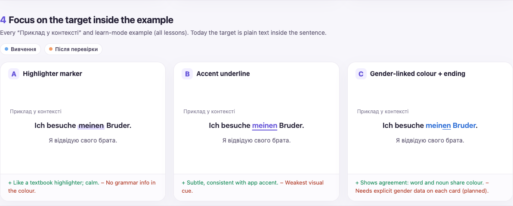

| Option | Design | Strength | Weakness |
|---|---|---|---|
| A | Highlighter marker behind the target | Calm, textbook-like | No grammar information in the colour |
| B | Accent underline | Subtle, matches the app accent | Weakest visual cue |
| **C ✅** | Gender-linked colour on the answer and its noun, ending underlined | Shows agreement: word and noun share a colour | Needs explicit gender data on each card |

**Decision:** C — gender-linked colour + underlined ending.

**In the app:** `Ich besuche` **`meinen Bruder`**`.` — both words take the noun's
gender colour, and the ending `-en` is underlined. Each highlighted word keeps its
own gender, so in `von den Bäumen` the plural form is highlighted in yellow even
though the headword starts with `der Baum`.
**Data:** `noun.exampleWord`, `noun.plural.exampleWord` and `answerParts`; each must
appear exactly once in the example.

## 5. Sentence structure

**Encodes:** German word order — position 1, the verb in position 2, the middle
field, and the end of the sentence (separable prefix, infinitive, participle).
**Applies to:** word order, separable verbs, modal verbs, Perfekt sentence builds.
**Visible:** learn (rule cards); after Check on sentence-build cards.

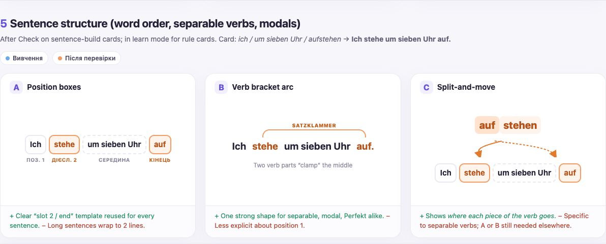

| Option | Design | Strength | Weakness |
|---|---|---|---|
| **A ✅** | Position boxes: `Поз. 1` · `Дієсл. 2` · `Середина` · `Кінець` | One clear "slot 2 / end" template for every sentence | Long sentences wrap to two lines |
| B | Verb-bracket arc (Satzklammer) joining the two verb parts | One strong shape for separable, modal and Perfekt | Less explicit about position 1 |
| C | Split-and-move: `auf\|stehen` with arrows to position 2 and the end | Shows where each piece of the verb goes | Separable verbs only; A or B still needed elsewhere |

**Decision:** A — position boxes.
The earlier provisional pick added C for separable verbs; that was not adopted.
If the boxes don't make the separable prefix obvious enough, C or B can be added
later for separable verbs only.

**Status:** rolled out (Phase 3) to the lessons in
[Phase 3 coverage](#phase-3-coverage).

**Phase 3 pilot.** Every separable-verbs card shows the boxes: the 10 vocabulary
cards and 4 pattern cards on the learn card (for the example or the rule sentence),
and the 14 sentence builds after Check. Details:

- Each card stores its fields explicitly (`structure`), one list per clause, so the
  boxes always rebuild the sentence word for word.
- The conjugated verb and the end of the sentence share one style (accent outline and
  tint): together they form the verb bracket. The middle box is dashed. Each box has
  its label underneath, so colour is not the only signal.
- Labels: `Поз. 1` · `Дієсл. 2` · `Середина` · `Кінець`; a subordinate clause starts
  with `Сполучник` and ends with the whole verb (`weil` · `ich früh` · `aufstehe`).
  Empty fields are left out, so `Ich verstehe die Aufgabe.` has no `Кінець` box.
- **Changed from the mock-up:** the verb boxes use the accent purple that every other
  verb visual uses (person strips, haben), not orange. Orange already means `sein` in
  the haben / sein panel, and Perfekt sentences will show both. Switch to orange if
  the purple makes the bracket too quiet.

**Phase 3 rollout.** The pilot was approved and the boxes now also run in word-order,
können and Perfekt. Rules used for the new cards:

- A yes/no question starts with the verb, so its first box is `Дієсл. 1`
  (`Kannst` · `du mir bitte` · `helfen`). A question word fills `Поз. 1` as usual
  (`Wohin` · `kannst` · `du mit dem Auto` · `fahren`).
- `Кінець` holds verb parts only: an infinitive, a participle or a separable prefix.
  `spazieren gehen` stays together at the end. Noun parts of a verb phrase stay in
  the middle (`im Winter oft Ski` · `fahren`; `gut Gitarre` · `spielen`), and so do
  words after `sein` (`Der Mann` · `ist` · `da`).
- The whole middle field is one box, even in long TE-KA-MO-LO sentences, where it
  wraps to two lines on a phone. Splitting it into TE / KA / MO / LO boxes is a
  possible later addition.
- Perfekt frame cards show the haben / sein panel and the boxes together; the
  auxiliary sits in `Дієсл. 2` and the participle in `Кінець`.
## 6. Pictures for concrete words

**Encodes:** the meaning of concrete nouns and verbs (transport, places, food,
seasons, landmarks).
**Applies to:** travel, everyday, es gibt / leisure, directions.
**Visible:** learn cards; in practice before Check, because a picture shows meaning,
not the German answer.

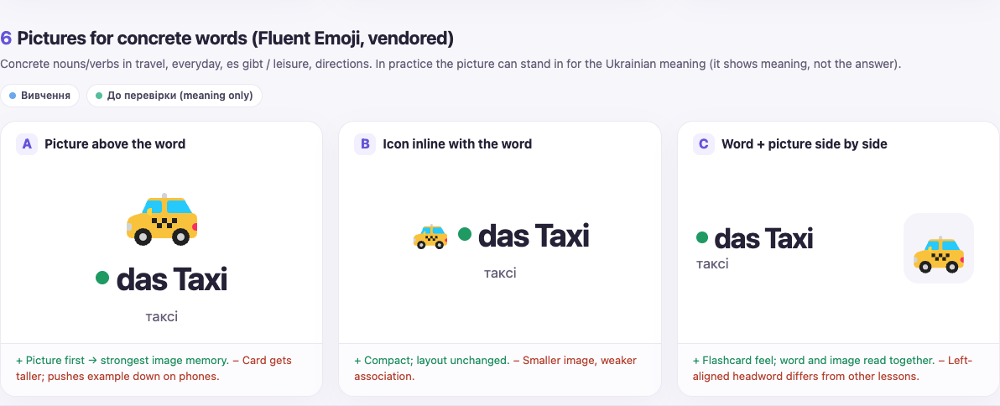

| Option | Design | Strength | Weakness |
|---|---|---|---|
| **A ✅** | Picture above the word | Picture first gives the strongest image memory | Card gets taller; pushes the example down on phones |
| B | Small icon inline with the word | Compact; layout unchanged | Smaller image, weaker association |
| C | Word and picture side by side | Flashcard feel | Left-aligned headword differs from other lessons |

**Decision:** A — picture above the word.

**Source:** Microsoft Fluent Emoji Flat SVGs (MIT licence), stored in the repository
with their licence file, never loaded from a CDN. If no picture fits a word, show
none rather than a misleading one.
**Status:** rolled out (Phase 5); see [Phase 5 coverage](#phase-5-coverage).

**Phase 5 pilot.** 21 of the 37 travel-transport cards have a picture, on their learn
card and in practice:

| Card | Picture (`assets/icons/`) |
|---|---|
| der Bahnhof, der nächste Bahnhof | `station` — train front with a platform sign |
| der Flughafen | `airplane-departure` |
| die S-Bahn | `light-rail` |
| das Taxi | `taxi` |
| der Bus | `bus` |
| der Zug, mit dem Zug fahren | `high-speed-train` — side view |
| die Straßenbahn | `tram-car` |
| die U-Bahn | `metro` |
| das Flugzeug, mit dem Flugzeug fliegen | `airplane` |
| das Gleis | `railway-track` |
| der Koffer | `luggage` |
| die Tasche | `handbag` |
| das Gepäck | `baggage-claim` |
| die Haltestelle, an der Haltestelle | `bus-stop` |
| anrufen | `telephone-receiver` |
| einkaufen | `shopping-cart` |
| fernsehen | `television` |

Details:

- **No picture:** `der Bahnsteig`, because no icon shows a platform without looking
  like the station or the track. Also none for directions and abstract words
  (`nach Paris`, `die Fahrt`, `ca.`, `dort`, `neben` …) or for movement verbs
  (`umsteigen`, `einsteigen`, `abfahren` …), where one icon cannot tell them apart.
- **Same noun, same picture:** a phrase reuses its noun's picture (`der Bahnhof` and
  `der nächste Bahnhof` both show the station). Across all lessons a picture means one
  word or one noun, and a noun always shows the same picture (`das Restaurant` in
  time-worksheet-vocabulary and es-gibt-leisure). Singular and plural count as one
  noun (`Es gibt ein Café.` and `Es gibt viele Cafés.`).
- **Shown before Check in practice:** every practice card with a picture shows its
  meaning first — the Ukrainian word, or the translated sentence on gap cards — so the
  picture repeats the prompt and reveals nothing.
- **Size:** 96 px above the word on a computer, 76 px on a phone, as in the mock-up.
- **Screen readers** skip the picture (`alt=""`), because the translation already
  says what it shows.
- **Files:** 17 SVGs of 1–3 KB in the pilot; 50 SVGs (0.5–20 KB, 142 KB in total)
  after the rollout, in `assets/icons/`, with the MIT `LICENSE` next to them. A card
  loads only its own picture. Each card names its file in the `picture` field.

## 7. Frequency scale

**Encodes:** how often (`immer … nie`) as a position on a scale.
**Applies to:** the frequency lesson; reused for frequency words in other lessons.
**Visible:** learn cards; practice before Check (it shows meaning).

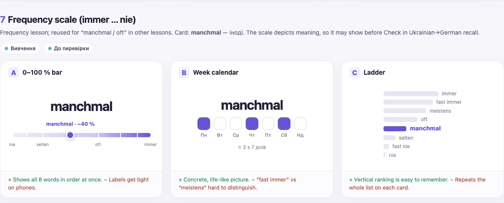

| Option | Design | Strength | Weakness |
|---|---|---|---|
| **A ✅** | 0–100 % bar with all adverbs in order, the current one marked | Shows all eight words in order at once | Labels get tight on phones |
| B | Week calendar (`≈ 3 з 7 днів`) | Concrete, life-like | `fast immer` vs `meistens` hard to tell apart |
| C | Vertical ladder | Ranking is easy to remember | Repeats the whole list on every card |

**Decision:** A — 0–100 % bar.
**Status:** rolled out (Phase 4); see [Phase 4 coverage](#phase-4-coverage).

**Phase 4 pilot.** All 8 learn cards and all 8 practice cards in the frequency lesson
show the bar. Details:

- Each card stores the scale and its own step explicitly (`frequency`). Approximate
  values: `nie` 0 %, `fast nie` 10 %, `selten` 25 %, `manchmal` 40 %, `oft` 60 %,
  `meistens` 75 %, `fast immer` 90 %, `immer` 100 %. These show the order, not
  exact statistics; change them if one feels wrong.
- Learn cards and practice after Check: caption `manchmal · ≈ 40 %`, a marker on the
  bar, and all eight words placed at their percent. Labels alternate below and above
  the bar so they fit on a phone; the card's own word is highlighted.
- Practice before Check: the answer is a German adverb, so the bar shows no German
  words, only the marker, `≈ 40 % часу` and the `0 %` / `100 %` ends. The labels
  appear after Check.
- **Changed from the mock-up:** words are spaced by their percent instead of evenly,
  and alternate above and below instead of sitting in one row, which crowded on
  phones.

## 8. Clock for time expressions

**Encodes:** clock time as Germans say it (`Viertel nach drei`, `halb vier`).
**Applies to:** time expressions and the time worksheet.
**Visible:** learn cards; practice before Check (the clock shows the prompt time,
not the phrase).

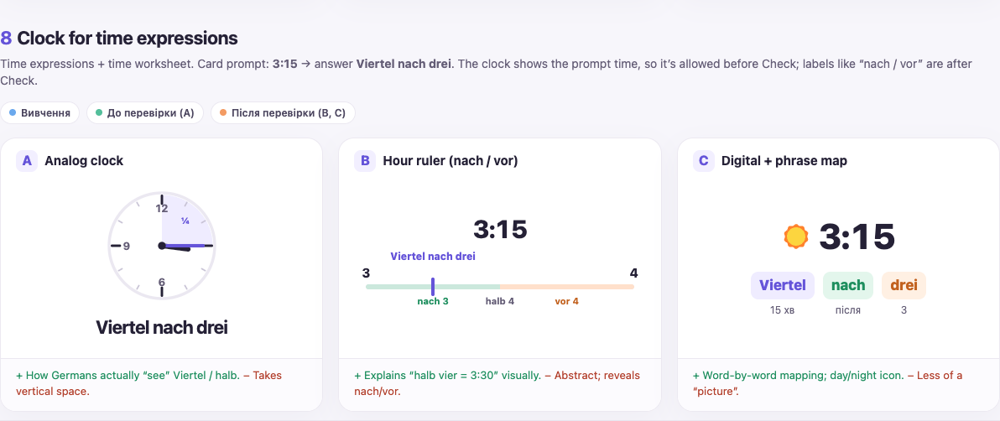

| Option | Design | Strength | Weakness |
|---|---|---|---|
| **A ✅** | Analog clock face | How Germans actually "see" Viertel and halb | Takes vertical space |
| B | Hour ruler marking `nach` / `vor` / `halb` | Explains `halb vier = 3:30` | Abstract; reveals nach/vor, so after Check only |
| C | Digital time + word-by-word phrase map | Exact mapping; day/night icon | Less of a picture |

**Decision:** A — analog clock.
**Status:** rolled out (Phase 4); see [Phase 4 coverage](#phase-4-coverage).

**Phase 4 pilot.** The 5 spoken-time learn cards and the 5 spoken-time practice cards
show the clock above the headword or prompt. Details:

- Each card stores its time explicitly (`clock: {hour, minute}`), taken from the
  digital time (`3:15`). The hour hand moves between hours, so at `halb vier` it
  sits halfway to 4.
- Before Check the face shows only the hands, which repeat the prompt time. In the
  gap-fill variant the prompt is `___`, so the clock is the only place the time is
  given.
- Learn cards and practice after Check: a shaded sector shows the span German
  counts, with a Ukrainian reading underneath — `¼ години після 3`
  (Viertel nach drei), `½ години до 4` (halb vier), `10 хв до 6`
  (zehn vor sechs). Times like `3:25` read `5 хв до пів на 4` and `3:35`
  `5 хв після пів на 4`; a full hour has no sector.
- **Changed from the mock-up:** no `¼` mark inside the face, because it collided
  with the hands and numerals; the reading underneath says it instead. The numerals
  sit above the hands with a white outline so a hand never hides them.

## 9. haben vs sein in Perfekt

**Encodes:** why a verb takes *sein* (movement from A to B, or a change of state) or
*haben* (an action, with or without an object, and no movement).
**Applies to:** Perfekt and past-verb lessons.
**Visible:** learn cards; after Check in practice (the auxiliary is the decision).

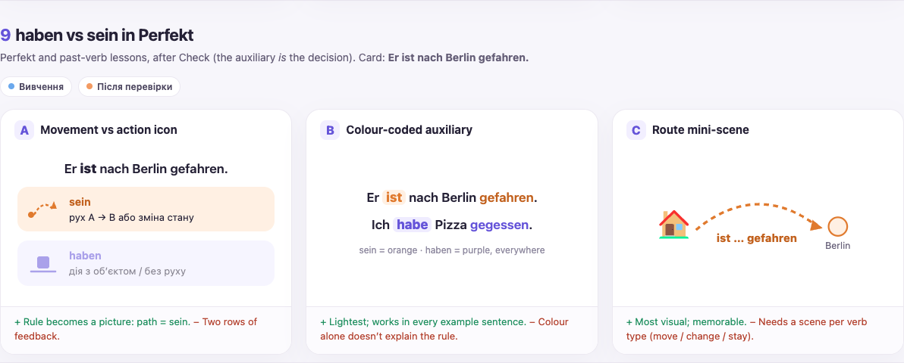

| Option | Design | Strength | Weakness |
|---|---|---|---|
| **A ✅** | Movement vs action icon: a path icon for *sein*, a hand icon for *haben* | The rule becomes a picture: path = sein | Two rows of feedback |
| B | Colour-coded auxiliary (sein orange, haben purple) everywhere | Lightest; works in every sentence | Colour alone doesn't explain the rule |
| C | Route mini-scene per verb | Most visual; memorable | Needs a scene for each verb type |

**Decision:** A — movement vs action icon.

**In the app (perfekt pilot):** under the translation, a caption
`Perfekt · haben чи sein` and two rows. *sein* has a dashed path from a dot to an
arrow and the rule *рух A → B або зміна стану*. *haben* has a box resting on a line
and the rule *дія з об’єктом / без руху*. The box on a line is taken from the
mock-up; the option table's "hand icon" describes the same idea. The card's choice is
outlined and tinted (sein orange `#a34d00`, haben violet `#6554d9`) and marked as
current for screen readers. Unlike the mock-up, the other row is not faded, so its
text keeps 4.5:1 contrast. The auxiliary in the example sentence takes the same
colour (`Er `**`ist`**` nach Berlin gefahren.`). In the frame-learn formulas
(`haben + gemacht`) the infinitive is highlighted.
**Where:** the frame and the haben-or-sein stages (learn cards; practice after Check).
The Partizip II stages do not show it, because there the auxiliary is not the decision.
**Data:** `auxiliary: { verb: "haben" | "sein", form }`, where `form` occurs once in
the sentence.

**Rolled out (Phase 2):** every card in past-verbs (A1), past-verbs-a2 and
past-verbs-b1 whose Perfekt form starts with `hat` or `ist` shows the panel on learn
cards and after Check. The auxiliary is read from the card's Perfekt form, so it never
disagrees with the answer. When the example sentence is in Perfekt, its present-tense
auxiliary is coloured (`Ich `**`bin`**` zu Hause geblieben.`). When the example is in
Präteritum (`Als Kind durfte ich lange aufbleiben.`), the panel still shows the
auxiliary but nothing in the sentence is coloured. Verbs that take both
(`schwimmen`, `brechen`, `frieren`, `reiten`, `scheiden`, `schießen`, `treten`:
`hat/ist …`) show no panel, because the choice depends on the meaning.

## 10. Rule tables in the guide

**Encodes:** the whole paradigm as a pattern, and what changes from one case to
the next.
**Applies to:** the "Правила" panel of every lesson that teaches a paradigm.
**Visible:** guide panel. During practice, a table or note that contains an accepted
answer is hidden until Check.

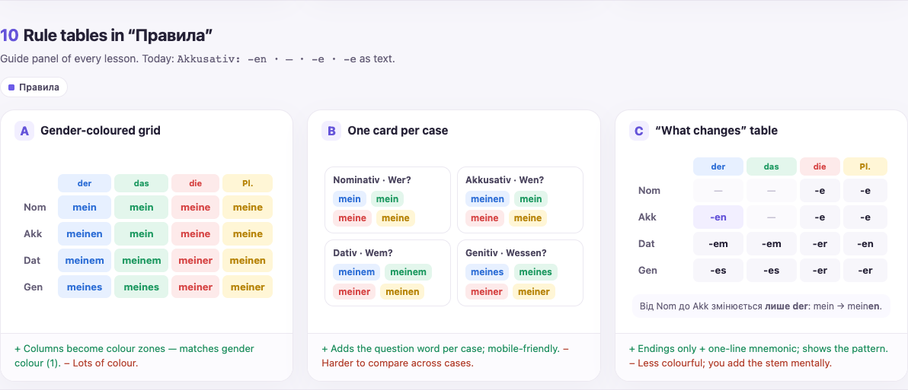

| Option | Design | Strength | Weakness |
|---|---|---|---|
| A | Gender-coloured grid of full forms | Columns become colour zones | Lots of colour |
| B | One card per case, with its question word (`Wen?`, `Wem?`) | Mobile-friendly; adds the question | Harder to compare cases |
| **C ✅** | "What changes" table: endings only, neutral cells, coloured column headers, changed cells highlighted, plus a one-line note | Shows the pattern | Less colourful; you add the stem mentally |

**Decision:** C — "what changes" table.

**In the app (possessive-cases, rule 2):** rows Nom., Akk., Dat.; columns der, das,
die, Plural with gender-coloured header chips; `—` in muted grey; the Akk. × der
cell (`-en`) highlighted in lavender. The note reads:
*"Від Nominativ до Akkusativ змінюється лише der: додається -en. Das, die і Plural
не змінюються."* The note describes the change in words, so the highlight is not the
only signal. Unlike the mock-up, it avoids full word forms such as *meinen*, so it
stays visible during practice. The mock-up's Genitiv row is left out because the
lesson covers Nominativ, Akkusativ and Dativ.
**Case order:** every case table and strip lists Nom., Akk., Dat. in that order
(question rows follow their case: `Wohin?` before `Wo?`).
**Data:** a guide rule's `table: { columns, rows, highlights, note }`. Highlighted
cells are listed explicitly (`highlights: [{ row, column }]`). A row may carry a
`gender` (shown as a dot before its label) for person rows such as `er`, `sie`, `es`.

**Rolled out to:** possessives (Nominativ endings), es gibt (ein → einen), local
prepositions (Nom. vs Wohin? vs Wo? articles), travel (`mit` + Dativ articles),
dative verbs (Nom. vs Dat. articles), personal-pronoun cases (Akkusativ and Dativ by
person) and conjugation (`mach-` vs `arbeit-` endings). The pronoun and conjugation
tables list the forms the lesson asks for, so they show on learn cards and after
Check only.

**Phase 2 pilot (strong-verbs, rule 5):** the stem vowel by person: rows `e → i`,
`e → ie`, `a → ä`, `i → ei` (hover shows the verbs), columns `ich`, `du`,
`er/sie/es`, `wir/ihr/sie`, changed vowels highlighted. The note names the verbs of
each row. The cells hold only vowels, so the table stays visible during practice.

**Rolled out (Phase 2):**
- *sein:* `Однина` / `Множина` by person (`ich bin` … `sie/Sie sind`), with both
  `sind` cells highlighted.
- *haben:* the six forms of haben, bekommen and brauchen side by side; `hast` and
  `hat` (the forms without b) are highlighted.
- *können:* the six forms of können, mögen and möchten side by side; the singular of
  können and mögen (`ö → a`, no ending in ich and er/sie/es) is highlighted. The rule
  also names the three meanings.

These tables hold the answers, so they show on learn cards and after Check only.

## 11. Library class map

**Encodes:** what kind of knowledge a lesson trains, and where that kind sits on the
course path: words → word forms → choosing a form by rule → word order.
**Applies to:** the library screen, all lessons.
**Visible:** library.

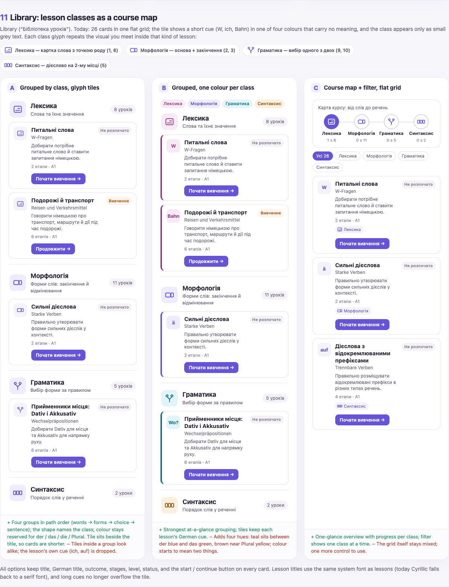

| Option | Design | Strength | Weakness |
|---|---|---|---|
| **A ✅** | Lessons grouped by class in course-path order. The group heading and every card carry a purple glyph tile drawn from the visual that class uses inside its lessons | The shape names the class and links the library to what you see in the lesson; colour stays reserved for gender | Groups differ in size (2 to 11 lessons) |
| B | The same groups, each class in its own colour (tile and card edge) | Classes stand apart at a glance | Four extra hues sit close to der blue and das green and weaken the gender code |
| C | A four-step course map with filter chips above one mixed grid | Compact; one tap shows one class | The grid stays mixed, so a card does not show its class |

**Decision:** A — groups by class with glyph tiles. *Provisional:* chosen without the
learner, who asked for autonomous work. To switch to B or C, follow
[How to change a decision](#how-to-change-a-decision); the gallery keeps all three.

| Class | Summary in the app | Glyph | Miniature of |
|---|---|---|---|
| Лексика | Слова та їхнє значення | Word card with a dot | Picture and gender-dot word card (1, 6) |
| Морфологія | Форми слів: закінчення й відмінювання | Stem box + filled ending box | Stem + ending split and case strip (2, 3) |
| Граматика | Вибір форми за правилом | Fork with the chosen branch filled | haben / sein choice and guide tables (9, 10) |
| Синтаксис | Порядок слів у реченні | Three boxes, the second filled | Position boxes, verb in position 2 (5) |

**In the app:** the four groups follow the order above. A group heading shows the
glyph (44 px), the class name, its summary and the lesson count (`8 уроків`). A
lesson card shows a small glyph, the Ukrainian and German titles, the outcome, the
number of stages, the level, the status and the action button. The class name is not
repeated on the card because the group heading shows it. The old per-lesson colours
and text badges (`mein`, `Alltag`, `Bahn` …) are gone; the longer badges overflowed
their tile on phones. Glyphs are hidden from screen readers; each group is labelled
by its heading.
**Data:** each lesson's `className` in the lesson catalog (`app.js`). The ordered
`lessonClasses` list gives each class its glyph and summary. Lessons inside a group
keep the course order. A lesson with an unknown class gets its own group after the
four, without a glyph.

## 12. Illustrations in the guide rules

**Encodes:** the rule's own example as the picture the learner meets on the cards:
where the verb parts stand, haben or sein, how often, what time, Wo? or Wohin?, or
what a word means.
**Applies to:** the "Правила" panel of every lesson where an approved component fits
a rule; see [Phase 7 coverage](#phase-7-coverage).
**Visible:** guide panel. During practice, an illustration that shows an accepted
answer (one of its words, or a clause read whole) is hidden until Check, and the
answer note explains why.

No gallery options: the illustration reuses the chosen designs unchanged, so a
change to component 5, 6, 7, 8 or 9 changes it too.

| Kind (`visual` key) | Component | In the guide |
|---|---|---|
| `structure` | 5A position boxes | The rule's example sentence, verb parts in the accent |
| `auxiliary` | 9A haben / sein panel | Both rows; the rule's verb is marked, or neither when the rule compares them. Side by side when there is room |
| `frequency` | 7A 0–100 % bar | The whole scale, every German step named, no active step |
| `clocks` | 8A analog clock | One tile per time: clock (96 px) with the span, the German time, the Ukrainian reading |
| `scenes` | Local-preposition scenes | One tile per scene with its `Wo?` / `Wohin?` cue and sentence |
| `pictures` | 6A vocabulary picture + 1A gender dot | One tile per word: picture (48 px), dot and article + noun |

**In the app:** the illustration sits in a pale lavender panel under the rule's
formula, before any table. Tiles wrap and centre, so two or three fit on a 390 px
phone. Below 420 px the panel also uses the space under the rule number. A rule shows
at most one illustration, every word in it also appears in the rule's own text, and
the same panel is not repeated down a guide: perfekt shows haben on rule 2 and sein
on rule 3 only.
**Data:** a guide rule's `visual`, with exactly one of `structure` (clauses built
with `mainClause`, `subordinateClause` or `verbFirstClause`), `auxiliary`
(`{ verb }` or `{}`), `frequency` (`{ scale: frequencyScale }`), `clocks`
(`[{ hour, minute, text }]`), `scenes` (`[{ kind, motion, cue, text }]`) or `pictures`
(`[{ picture, noun }]` or `[{ picture, word }]`). A plain-text rule that needs an
illustration becomes `{ detail, visual }` and still reads as plain text.

---

## Colour tokens

The gallery used brighter colours. The app uses darker shades so coloured text keeps
at least 4.5:1 contrast on white and on its tint.

| Gender | Text / dot | Tint | Gallery original |
|---|---|---|---|
| der (masculine) | `#2459b8` | `#e7f0ff` | `#2f6fd6` |
| das (neuter) | `#167a4c` | `#e3f6ec` | `#1f9a62` |
| die (feminine) | `#b73232` | `#fdeaea` | `#d64545` |
| Plural | `#8a6200` | `#fff6d6` | `#b8860b` |

Defined in `lesson-journey.css` as `--g-m`, `--g-n`, `--g-f`, `--g-pl` and their
`-bg` tints.

## Text fit and fonts

These rules keep every visual readable from a 320 px phone to a desktop.

- **Long words shrink, never overflow.** The headword, the practice prompt and the
  strip tiles know their longest run that cannot wrap (`--fit-chars`). The font size
  is the smaller of the normal size and what fits that run into the card, so
  `der Weihnachtsmann` or `die Schwimmbäder` shrinks a little instead of running past
  the card edge or breaking mid-word. A strip uses one size for all its tiles.
- **Slashes break between alternatives.** In `das Kino / die Kinos` or
  `die Vase / auf den Tisch / ich / stelle`, a line may break only after a slash: an
  alternative or a sentence-build chunk stays whole, and the slash stays with the
  word before it. The copied text is unchanged.
- **Guide tables fit beside the rule number.** On phones the table tightens its
  spacing and, at 320 px, also uses the space under the rule number.
- **320 px.** The lesson header and card label wrap long Ukrainian words instead of
  running under the buttons. Labels keep at least 14 px and the lesson title 16 px.
- **Fonts cover Cyrillic.** Space Grotesk and DM Sans have no Cyrillic letters, so
  the browser used to draw Ukrainian headings in a fallback serif. Ukrainian
  headings now use the system font; Space Grotesk stays on numbers and Latin text.

A single-line answer field still scrolls a long sentence; after Check, the full
sentence is shown in the feedback above it.

## Rollout

Each phase that adds a new design is piloted on one lesson and reviewed before it
reaches other lessons.

| Phase | Scope | Components | Pilot lesson | Status |
|---|---|---|---|---|
| 0 | Shared foundation: metadata, renderer, reveal rules | — | local-prepositions (parity) | Done |
| 1 | Gender colours, example focus, guide tables | 1, 4, 10 (+ 2, 3 for possessives) | possessive-cases | Rolled out |
| 2 | Morphology: stem/ending, vowel change, paradigms, haben/sein | 2, 3, 9 (+ 10 for verbs) | strong-verbs; perfekt for 9 | Rolled out |
| 3 | Sentence structure | 5 | separable-verbs | Rolled out |
| 4 | Concept visuals | 7, 8 | frequency; time-expressions | Rolled out |
| 5 | Vocabulary pictures | 6 | travel-transport | Rolled out |
| 6 | Library by lesson class | 11 | — (one screen) | Rolled out, provisional |
| 7 | Illustrations in the guide rules | 12 (reuses 5, 6, 7, 8, 9) | — (no new design) | Built, awaiting review |

Every phase was checked with the test suite, screenshots on a 320 px and a 390 px
phone and on desktop, an overflow sweep, and a before/after comparison of all lesson
data. Reduced motion, keyboard-only use and a screen reader were not checked phase by
phase. Check them before treating the rollout as final.

### Phase 1 coverage

| Lesson | Gender line and example focus (1, 4) | Stem + ending, case strip (2, 3) | Guide table (10) |
|---|---|---|---|
| possessive-cases | Every card | Every card | Nom. / Akk. / Dat. endings |
| possessives | Nominativ possessive cards (`mein Bruder`, `deine Freunde`, `ihre Tasche` …) | Nominativ possessive cards | Nominativ endings |
| local-prepositions | Every card; shown in practice because the gap gives the noun | — | Nom. / Wohin? / Wo? articles |
| temporal-prepositions | Event and time-span cards; event cards show it in practice (the gap gives the noun), span cards after Check | — | Nom. / Akk. / Dat. articles |
| es-gibt-leisure | Places with singular and plural, pattern cards | — | ein → einen |
| travel-transport | Transport, places and phrases with a noun | — | `mit` + Dativ |
| time-worksheet-vocabulary | Season, weather and nature nouns | — | — |
| everyday-vocabulary | Food nouns | — | — |
| giving-directions | Landmarks | — | — |
| dative-verbs | — | — | Nom. vs Dat. articles |
| personal-pronoun-cases | — | — | Nom. / Akk. / Dat. forms by person |
| conjugation | — | — | `mach-` vs `arbeit-` |

### Phase 2 coverage

| Lesson | Stem + ending, person strip (2, 3) | haben / sein panel (9) | Guide table (10) |
|---|---|---|---|
| strong-verbs | Every card; vowel change marked | — | Stem vowel by person |
| sein | Every card | — | Forms by person and number |
| conjugation | Every card; caption names extra e or du -t | — | `mach-` vs `arbeit-` (Phase 1) |
| haben | Every card (haben, bekommen, brauchen) | — | haben vs bekommen vs brauchen |
| koennen | Form cards (können, mögen, möchten); `ö → a` marked | — | können vs mögen vs möchten |
| personal-pronoun-cases | Every card; Nom. / Akk. / Dat. pronoun strip | — | Akkusativ / Dativ by person (Phase 1) |
| perfekt | — | Frame and haben-or-sein stages | — |
| past-verbs, past-verbs-a2, past-verbs-b1 | — | Every card except `hat/ist` verbs | — |

### Phase 3 coverage

Position boxes (5) appear on learn cards and after Check on sentence builds.

| Lesson | Learn cards | Sentence builds |
|---|---|---|
| separable-verbs | All 14 (vocabulary and pattern cards) | All 14 |
| word-order | All 15 rule cards | All 22 |
| koennen | 4 word-order rule cards | 21 (word-order practice stage) |
| perfekt | 6 frame cards | The same 6 frames in practice |
| temporal-prepositions | 15 sentence cards | The same 15 in practice |

Other können cards (forms and gap fills) and the other Perfekt cards (haben or sein,
participle forms) have no boxes: they practise a single form, not the sentence order.

### Phase 4 coverage

| Lesson | Frequency bar (7) | Clock (8) |
|---|---|---|
| frequency | All 8 learn and 8 practice cards | — |
| time-expressions | — | 5 spoken-time learn cards and 5 spoken-time practice cards |

The pilot already covers every card that has a frequency adverb or a clock time as its
target, so the rollout adds no new lessons. Other lessons only use these words inside
example sentences (`Im Sommer schwimmen wir oft.`), where the target is a different
word. time-worksheet-vocabulary has no clock times. The `um` cards
(`um neun Uhr`) have no clock: in the mixed um / am / im drill a clock that appears
only on `um` cards would give away the answer before Check.

### Phase 5 coverage

Pictures (6) appear on learn cards and in practice, before and after Check. 62 of the
110 cards in these lessons have one; the files are in `assets/icons/`.

| Lesson | Cards with a picture (`file`) |
|---|---|
| travel-transport | 21 of 37 — see the [Phase 5 pilot table](#6-pictures-for-concrete-words) |
| everyday-vocabulary | 3 of 9: der Kräutertee (`teacup-without-handle`), die Süßigkeiten (`candy`), der Brei (`bowl-with-spoon`) |
| time-worksheet-vocabulary | 10 of 15: der Baum (`deciduous-tree`), das Blatt (`leaf-fluttering-in-wind`), die Kirche (`church`), das Restaurant (`fork-and-knife-with-plate`), der Weihnachtsmann (`santa-claus`), blühen (`blossom`), der Pilz (`mushroom`), das Fitnessstudio (`person-lifting-weights`), die Wärme (`sun`), der Vogel (`bird`) |
| giving-directions | 5 of 13: geradeaus (`up-arrow`), nach rechts (`right-arrow`), nach links (`left-arrow`), bis zur Ampel and an der Ampel (`vertical-traffic-light`) |
| es-gibt-leisure, `es gibt` cards | 4 of 5: Es gibt einen Park. (`national-park`), Es gibt eine Ausstellung. (`framed-picture`), Es gibt ein Café. and Es gibt viele Cafés. (`hot-beverage`) |
| es-gibt-leisure, places | All 11: das Kino (`clapper-board`), das Theater (`performing-arts`), das Museum (`classical-building`), das Café (`hot-beverage`), die Ausstellung (`framed-picture`), die Disco (`mirror-ball`), das Schwimmbad (`person-swimming`), das Konzert (`musical-notes`), die Kneipe (`beer-mug`), das Restaurant (`fork-and-knife-with-plate`), die Bar (`cocktail-glass`) |
| es-gibt-leisure, activities | 5 of 11: ins Kino gehen (`clapper-board`), ein Konzert besuchen (`musical-notes`), im Café Kaffee trinken (`hot-beverage`), das Gebäck (`croissant`), tanzen (`woman-dancing`) |
| es-gibt-leisure, photo | 3 of 4: auf dem Foto (`camera-with-flash`), denken (`thinking-face`), der Mensch (`bust-in-silhouette`) |

Cards without a picture, and why:

- **No icon tells them apart:** `der Kaugummi` (no gum icon); `die Sekunde` and
  `die Minute` (two clocks would look the same); `fallen` (a falling leaf would repeat
  `das Blatt`); `zurück`, `wenden`, `abbiegen` (one arrow cannot show the
  difference); `an der Kreuzung`, `die erste Straße links`, `über die Straße gehen`.
- **Abstract words:** sequence and routine words (`zuerst`, `danach`, `anfangen` …),
  `verbringen`, `genießen`, `besuchen`, `interessant`, `langweilig`, `denn`,
  `ein paar`, `das ganze Jahr`, `etwas`, `in der Nähe von`, and the rule card
  `Es gibt + Akkusativ`.
- **Gap drills on grammar:** the 5 es-gibt practice cards ask for `gibt` or an
  article, not for a word's meaning, so they have no picture.

Long headwords such as `der Weihnachtsmann` and `die Schwimmbäder` used to run past
the card edge on a 390 px phone screen, before and after Phase 5. They now shrink to
fit; see [Text fit and fonts](#text-fit-and-fonts).

Lessons not listed in a coverage table keep their current look until a later phase
reaches them.

### Phase 6 coverage

The library is one screen, so Phase 6 had no pilot lesson. It groups all 29 lessons:

| Class | Lessons |
|---|---|
| Лексика (8) | w-questions, pronouns, frequency, time-worksheet-vocabulary, everyday-vocabulary, travel-transport, giving-directions, dative-verbs |
| Морфологія (12) | personal-pronoun-cases, possessives, possessive-cases, sein, werden, conjugation, strong-verbs, past-verbs, past-verbs-a2, past-verbs-b1, perfekt, present-practice |
| Граматика (7) | koennen, haben, local-prepositions, time-expressions, temporal-prepositions, es-gibt-leisure, mit-ohne |
| Синтаксис (2) | word-order, separable-verbs |

### Phase 7 coverage

41 guide rules in 20 lessons carry an illustration (rule numbers as shown in the
guide).

| Lesson | Rule: illustration |
|---|---|
| w-questions | 1 `Wo wohnst du`, 2 `Wann kommt ihr` (boxes) |
| word-order | 2–5 the modal sentence `Ich mag am Morgen Kaffee trinken` as statement, inversion, ja/nein and W-question; 6 `Heute fahre ich …` (boxes) |
| separable-verbs | 1 `Ich stehe früh auf`, 2 `Warum rufst du mich an`, 3 `weil ich früh aufstehe`, 4 `Wir können früh aufstehen`, 5 `Ich verstehe die Aufgabe` (boxes) |
| frequency | 1 the whole bar; 2 `Ich lerne oft Deutsch`, 3 `Am Sonntag lese ich manchmal ein Buch` (boxes) |
| perfekt | 1 `Ich habe die Hausaufgaben gemacht` (boxes); 2 haben, 3 sein (panel) |
| past-verbs, past-verbs-a2, past-verbs-b1 | The "Haben або sein" rule (panel, neither marked) |
| koennen | 3 `Ich kann schwimmen` (boxes) |
| werden | 4 `Ich werde Lehrer` (boxes) |
| strong-verbs | 4 `Der Kurs fängt um neun Uhr an` (boxes) |
| everyday-vocabulary | 2 `Der Kurs fängt um neun Uhr an` (boxes); 3 der Kräutertee, die Süßigkeiten, der Brei (pictures) |
| travel-transport | 1 der Bahnhof, die Haltestelle, das Gepäck (pictures); 4 `Der Zug fährt ab` (boxes) |
| giving-directions | 1 `Zuerst gehen Sie geradeaus`, 3 `Sie biegen links ab` (boxes); 2 geradeaus, nach rechts, nach links (arrows) |
| temporal-prepositions | 7 `um 9 Uhr` (clock); 8 `Nach der Arbeit gehe ich ins Fitnessstudio` (boxes) |
| mit-ohne | 8 `Mit dem Bus fahre ich zur Arbeit` (boxes) |
| time-expressions | 1 `um acht Uhr`; 6 `fünf nach zehn`, `zehn vor sechs`, `halb vier` (clocks) |
| local-prepositions | 1 Wo? (book in the drawer, vase on the table), 2 Wohin? (the same moving), 4 the dog under the chair, Wo? vs Wohin? (scenes) |
| time-worksheet-vocabulary | 1 der Baum, die Kirche, das Restaurant (pictures) |
| es-gibt-leisure | 3 das Museum, die Bar (pictures) |

Rules about endings or forms keep their tables (component 10) and get no extra
picture. Rules whose only fitting component would repeat the panel above them, or
whose example has no approved component (for example a sequence of `zuerst`,
`danach`), stay text only.

## Ideas not built

The first review proposed more visuals than the eleven components above (row 12
reuses them). The design
gallery narrowed the work to these components, so the ideas below were never built.
Each needs gallery options, a choice and a pilot before it is added.

| Idea | Where it would help | Note |
|---|---|---|
| Past-forms timeline: Infinitiv → Präteritum → Partizip II with the vowel changes marked | past-verbs, perfekt | |
| Stiefel (boot) outline around du and er/sie/es, the persons whose vowel changes | strong-verbs | The changed vowel is already marked in amber |
| A glyph for each question word | w-questions | |
| Person pictograms | pronouns, personal-pronoun-cases | |
| A mini route for directions | giving-directions | The direction words already have arrow pictures |
| Meaning icons for modal verbs and for haben / bekommen / brauchen | koennen, haben | |
| Giver → thing → receiver arrow | dative-verbs | |
| A colour for each case | case lessons | Conflicts with the one-meaning-per-colour rule |
| um ⊂ am ⊂ im scope picture | time-expressions | |
| Time, cause, manner and place colours in the middle field | word-order | Conflicts with the one-box middle field |
| Sentence-build chunks as tiles instead of slash-separated text | word-order, separable-verbs | |
| Link between a separable prefix and its verb; slot feedback for a misplaced chunk | separable-verbs, sentence builds | |
| Plural suffix highlight (`-e`, `-er`, `-n`, `-s`, umlaut) | noun plurals | |
| Feedback that compares the typed answer with the correct one by stem and ending | all form drills | |

An idea marked as a conflict also needs a change to the Constitution.

## Decision log

| Date | By | Choices | Notes |
|---|---|---|---|
| 2026-10-12 | Provisional (learner unavailable) | 1B 2A 3B 4C 5A+5C 6A 7A 8A 9A 10A | Used to build the Phase 1 pilot |
| 2026-10-12 | Learner | 1A 2A 3C 4C 5A 6A 7A 8A 9A 10C | Pilot updated: 1B → 1A, 3B → 3C, 10A → 10C; 5C dropped |
| 2026-10-12 | Learner | Pilot approved | Phase 1 rolled out to the lessons in [Phase 1 coverage](#phase-1-coverage); Phase 2 pilot started |
| 2026-10-12 | — | Phase 2 piloted | Vowel change (2A), person strip (3C) and guide table (10C) on strong-verbs; haben/sein panel (9A) on perfekt. Awaiting review |
| 2026-10-12 | Learner | Phase 2 pilot approved | Phase 2 rolled out to the lessons in [Phase 2 coverage](#phase-2-coverage) |
| 2026-10-12 | — | Phase 3 piloted | Position boxes (5A) on separable-verbs, verb boxes in the accent purple instead of the mock-up's orange. Awaiting review |
| 2026-10-12 | Learner | Phase 3 pilot approved | Phase 3 rolled out to the lessons in [Phase 3 coverage](#phase-3-coverage) |
| 2026-10-12 | — | Phase 4 piloted | Frequency bar (7A) on frequency, German labels after Check in practice; analog clock (8A) on the time-expressions spoken-time stages, sector and reading after Check. Awaiting review |
| 2026-10-12 | Learner | Phase 4 pilot approved | All Phase 4 choices confirmed (percent values, label layout, clock readings, no ¼ mark, placement); see [Phase 4 coverage](#phase-4-coverage) |
| 2026-10-12 | — | Phase 5 piloted | Vocabulary pictures (6A) on 21 travel-transport cards, also shown in practice before Check; `der Bahnsteig` has none. Awaiting review |
| 2026-10-12 | Learner | Phase 5 pilot approved | Phase 5 rolled out to the lessons in [Phase 5 coverage](#phase-5-coverage); a picture now means one word or noun across all lessons |
| 2026-10-12 | Learner | Defects fixed | Long headwords, prompts and strips shrink to fit; slash texts break only between alternatives; guide tables and the lesson header fit at 320 px; Ukrainian headings no longer fall back to a serif. See [Text fit and fonts](#text-fit-and-fonts) |
| 2026-10-12 | Provisional (learner unavailable) | 11A | Phase 6: library grouped by lesson class with glyph tiles; options B and C stay in the gallery. See [Phase 6 coverage](#phase-6-coverage) |
| 2026-10-12 | Learner | Design rules recorded | The colour roles, active versus inactive items, decorative parts, reduced motion, giveaways and each component's details moved into the Constitution. The ideas that were never built are listed in [Ideas not built](#ideas-not-built) |
| 2026-10-15 | Learner request | 12 | Phase 7: rule guides illustrated with the approved components (boxes, haben/sein, frequency bar, clocks, scenes, pictures); an illustration that would reveal the answer waits for Check. See [Phase 7 coverage](#phase-7-coverage). Awaiting review |

## Review notes

Record what you notice while practising, then use it to revisit a decision.

| Date | Component | What helped or got in the way | Change to try |
|---|---|---|---|
| | | | |

---

Screenshots show mock-ups from the design gallery, not the live app. Pictures in
option 6 are Microsoft Fluent Emoji (MIT licence).
